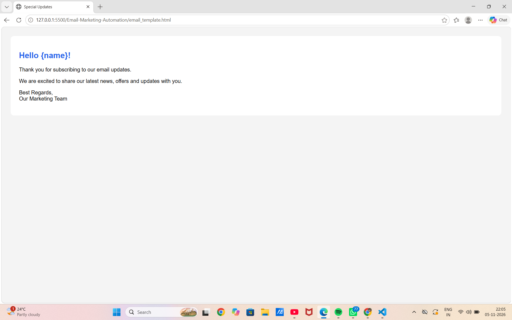
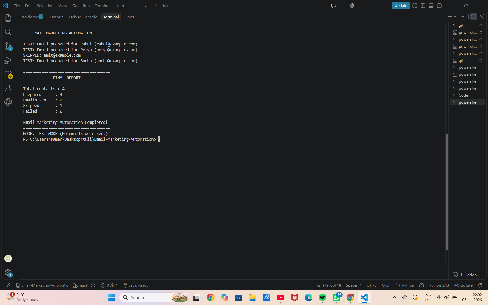

COMPANY: CODETECH IT SOLUTION
NAME:SUPARNA ADHIKARI INTERN ID:CITS8784
DOMAIN: DIGITAL MARKETING DURATION:12 WEEKS
MENTOR:NEELA SANTOSH KUMAR
DESCRIPTION: Task-1:Email Marketing Automation
📧 Email Marketing Automation

1. Project Overview

Email Marketing Automation is a Python-based project that automates sending personalized marketing emails to multiple contacts using Gmail SMTP.

The project reads contact information from a CSV file, checks subscription status, generates personalized HTML email messages, and sends emails automatically.

It also includes a Test Mode to verify email preparation without actually sending emails.

2. Features

- Automated email sending using Python.
- Personalized emails using recipient names.
- HTML email templates.
- CSV-based contact management.
- Subscription status verification.
- Gmail SMTP integration.
- Test Mode for safe testing.
- Error handling and execution reports.
- Secure email credentials using environment variables.

3. Technologies Used

- Python 3.13
- CSV Module
- SMTP (Simple Mail Transfer Protocol)
- HTML
- Python-dotenv
- Visual Studio Code

4. Project Structure

Email-Marketing-Automation/
│
├── .env
├── .env.example
├── .gitignore
├── contacts.csv
├── email_template.html
├── main.py
├── README.md
└── requirements.txt

5. Installation and Setup

Step 1: Install Python

Download and install Python from:

https://www.python.org/downloads/

Step 2: Open the Project

Open the project folder in Visual Studio Code.

Step 3: Install Required Packages

Open the VS Code terminal and execute:

python -m pip install -r requirements.txt

Step 4: Configure Environment Variables

Create a ".env" file in the project folder.

Add the following:

EMAIL_ADDRESS=your_email@gmail.com
EMAIL_PASSWORD=your_google_app_password
TEST_MODE=true

Note: Use a Google App Password instead of your regular Gmail password.

Step 5: Configure Contacts

Add contact details to "contacts.csv".

Example:

name,email,subscribed
Rahul,rahul@example.com,yes
Priya,priya@example.com,yes
Amit,amit@example.com,no
Sneha,sneha@example.com,yes

Only contacts with "yes" in the subscribed column will receive emails.

Step 6: Configure Email Template

The "email_template.html" file contains the design and content of the marketing email.

The "{name}" placeholder is replaced with the recipient's name automatically.

6. How to Run the Project

Open the terminal in your project directory and execute:

python main.py

The program will:

1. Load email credentials.
2. Read the HTML email template.
3. Read contact information from the CSV file.
4. Check subscription status.
5. Prepare personalized emails.
6. Send emails if Test Mode is disabled.
7. Display the final execution report.

7. Test Mode

The project initially runs in Test Mode.

TEST_MODE=true

In Test Mode:

- Emails are prepared but not sent.
- Subscribed contacts are processed.
- Unsubscribed contacts are skipped.
- The program displays the execution report.

To enable actual email sending, change:

TEST_MODE=false

Make sure your Gmail credentials and SMTP configuration are correct before enabling actual sending.

8. Expected Output

================================
    EMAIL MARKETING AUTOMATION
================================

TEST: Email prepared for Rahul
TEST: Email prepared for Priya
SKIPPED: amit@example.com
TEST: Email prepared for Sneha

================================
          FINAL REPORT
================================

Total contacts : 4
Prepared       : 3
Emails sent    : 0
Skipped        : 1
Failed         : 0

Email Marketing Automation Completed!

MODE: TEST MODE (No emails were sent)
## Project Output

Here is the output of my Email Marketing Automation project.

## [Email Marketing Automation Output]

9. Security

- Never share your ".env" file.
- Never upload email passwords to GitHub.
- Use Gmail App Passwords.
- Keep ".env" inside ".gitignore".
- Use Test Mode before sending actual emails.
- Send marketing emails only to contacts who have given permission.

10. Future Improvements

- Email scheduling.
- Email delivery tracking.
- Email open and click tracking.
- Graphical user interface (GUI).
- Email campaign analytics.
- Automated unsubscribe management.

11. Conclusion

The Email Marketing Automation project demonstrates how Python can be used to automate email marketing tasks efficiently.

It reduces manual effort, supports personalized communication, manages subscriber lists, and provides a simple reporting system.

This project is useful for learning Python automation, file handling, SMTP integration, HTML email design, and environment variable management.

---

Project Name: Email Marketing Automation
Language: Python
IDE: Visual Studio Code
Project Type: Automation
